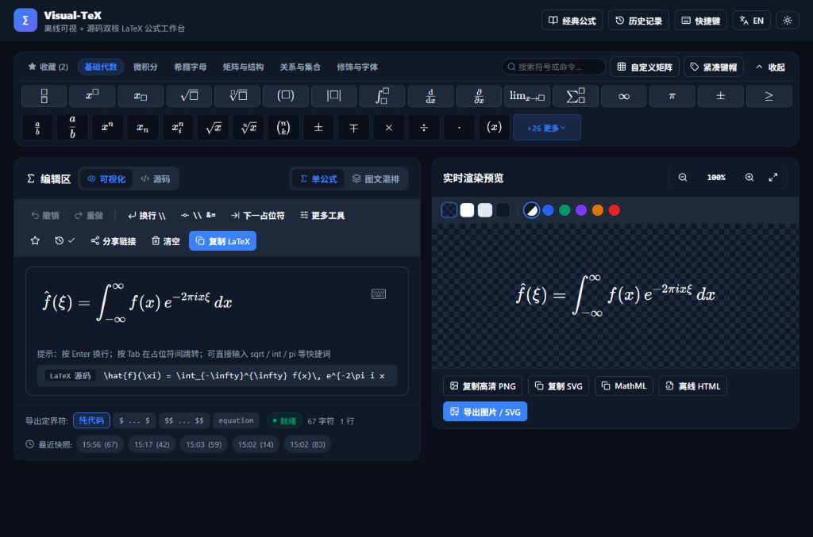
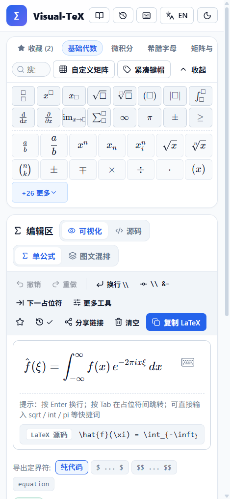
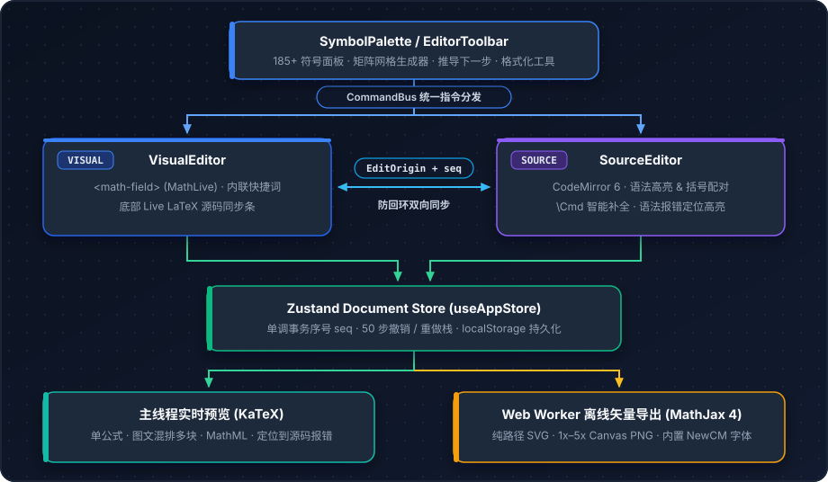

<div align="center">

# Visual-TeX

**面向科研、教育与工程排版的新一代 100% 离线可视 + 源码双核 LaTeX 公式与图文混排工作台**

[](https://aistudio.google.com/)
[](https://visual-tex.ai.studio)
[](LICENSE)

[](https://react.dev/)
[](https://www.typescriptlang.org/)
[](https://cortexjs.io/mathlive/)
[](https://katex.org/)
[](https://www.mathjax.org/)

<p>
  <strong>简体中文</strong> | <a href="./README_EN.md">English</a>
</p>

<p>
  <a href="https://visual-tex.ai.studio">在线体验</a> ·
  <a href="#-项目说明">项目说明</a> ·
  <a href="#-核心特性">核心特性</a> ·
  <a href="#-快速开始">快速开始</a> ·
  <a href="#-效率手册内联速记与快捷键">快捷速记</a> ·
  <a href="#-架构设计与目录结构">架构设计</a>
</p>

</div>

---

## 📖 项目说明

**Visual-TeX** 是一款专为科研写作、教学课件、工程文档与日常笔记打造的 **纯前端、100% 离线** LaTeX 公式编辑与图文混排工作台。

项目将 **可视化公式排版（MathLive）** 与 **专业代码控制力（CodeMirror 6）** 融为一体，围绕高频学术排版场景提供一体化工作流：

- **双核同步，自由切换**：支持可视化结构点选、免反斜杠内联快捷词录入，以及源码模式下的智能命令补全与语法错误精确定位，两者通过单调事务状态机毫秒级双向同步。
- **克制面板，零网依赖**：采用「16 键置顶常用核心栏 + 默认两行展开」的紧凑符号面板，减少大面积按钮墙对编辑视野的挤占；全部渲染与导出字体均打包在本地，断网环境下依旧可用。
- **出版级输出，多端可用**：主线程使用 KaTeX 进行亚毫秒级实时预览，后台 Web Worker 调用 MathJax 4 + NewCM 字体生成**纯路径矢量 SVG**、**1x–5x 高清 Canvas PNG** 与 **Word 原生 MathML**，并适配桌面、平板与手机端分辨率。

---

## ✨ 核心特性

### ⌨️ 双核无缝协同：MathLive 可视化 × CodeMirror 6 源码

- **所见即所得 `<math-field>` (MathLive)**：支持物理级数学光标导航、**选中包络（Wrap Selection）** 与全结构 `\placeholder{}` 槽位渲染；按 `Tab` / `Shift+Tab` 在占位符间顺畅跳转，按 `Enter` 自动换行、`Shift+Enter` 跳出父结构。
- **底部实时 LaTeX 同步条**：在可视化模式下无需来回切换 Tab，输入框底部内置可编辑 `LaTeX 源码` 栏，可随时查看、粘贴或微调底层代码，毫秒级双向同步。
- **CodeMirror 6 专业源码编辑器**：
  - 自定义 `StreamLanguage` LaTeX 语法高亮与 `{}` / `()` / `[]` 自动配对闭合。
  - 输入 `\` 自动触发命令补全浮层（覆盖 `\frac`、`\dfrac`、`\sqrt`、`\sum`、`\prod`、`\int`、`\lim`、`\mathbb`、`\begin{cases}`、`\begin{aligned}`、`\begin{pmatrix}` 等 26 项高频结构）。
  - 空格触发快捷展开（`>= ` → `\geq `、`-> ` → `\to `、`oo ` → `\infty `、`alpha ` → `\alpha ` 等），且自动跳过 `\text{}` 文本环境。
  - **语法报错精准定位**：预览出现异常时，点击错误横幅右侧「定位到源码」即自动切回源码视图并高亮选中出错区间。

### 🧮 双行紧凑符号面板（185+ 符号库）

- **16 键置顶常用核心栏**：分式、幂上标、下标、平方根、$n$ 次根、圆括号、绝对值、定积分、导数、偏导、极限、求和、无穷、$\pi$、$\pm$、$\ge$ 跨分类常驻单行（手机端自动重排为 8 列双行网格），高频输入零翻页。
- **6 大学科分类 185+ 符号 + 星标收藏夹 (`★`)**：覆盖 **基础代数**、**微积分**、**希腊字母**、**矩阵与结构**、**关系与集合**、**修饰与字体**，共包含 185+ 经 KaTeX 编译校验的双语符号与全 `\placeholder{}` 占位模板。
- **克制的两行默认视窗**：每类符号默认只展示前两行核心键帽，通过内联 `+N 更多 ▾ / 收起更多 ▴` 按需展开，同时支持 **紧凑键帽 / 显示名称** 视图切换。
- **交互式 1×1～6×6 矩阵网格生成器**：悬停直选任意行列矩阵与环境（`(pmatrix)`、`[bmatrix]`、`|vmatrix|`、`{cases}`），并在工具栏提供 `+ 行` / `- 行` / `+ 列` / `- 列` 快捷操作。
- **全局双语模糊搜索**：支持以中文名称、英文关键词或 LaTeX 命令即时过滤全库，按 `Enter` 一键插入首个匹配结果。

<div align="center">
  
</div>

---

### 🎨 100% 离线双引擎与出版级矢量导出

- **实时预览层 (`KaTeX`)**：主线程零延迟渲染，支持透明棋盘格 / 纯白 / 浅灰 / 深色画布切换、自定义前景色、50%～300% 无级缩放与适应宽度。
- **矢量导出层 (`Web Worker + MathJax 4 + NewCM`)**：在后台独立 Worker 线程完成从 TeX 到 **纯路径矢量 SVG** 的离线编译——完全无 `<foreignObject>` 与外部字体依赖，可直接无损导入 Figma、Illustrator、Inkscape、Typst 或学术排版流程。
- **原生 Canvas 2D 高清 PNG**：支持 **1x～5x 超采样倍率**、**紧凑 (`8px`) / 标准 (`16px`) / 宽松 (`32px`) 画布留白**，以及 **透明背景自适应微光描边**（确保公式在深色 PPT 与浅色论文中皆清晰锐利）。
- **多生态互操作**：一键复制 **PNG / SVG / Word 原生 MathML**、打包导出 **100% 离线独立 HTML**，或生成免后端的 **URL `#tex=` 分享链接**。

<div align="center">
  
</div>

---

### 📝 单公式精修 × 图文混排工作台 & 全端响应式适配

<table>
  <tr>
    <td valign="top">
      <h4>双文档工作流与推导助手</h4>
      <ul>
        <li><strong>单公式 × 图文混排一键切换</strong>：既可专注打磨一条复杂公式，也可在「图文混排」模式下自由穿插 Markdown 正文与多公式块，采用“单活动编辑器 + 静态 KaTeX 渲染”保证长文档流畅度。</li>
        <li><strong>工程化编辑工具</strong>：内置 <code>推导下一步 (\\ &amp;=)</code> 自动续写右式并对齐、一键 <strong>规范中文/半角</strong> 清洗与 <code>\text{}</code> 包裹、粘贴自论文/Word/AI 对话公式自动去定界符标准化。</li>
        <li><strong>Markdown 双向流转</strong>：支持直接粘贴或上传 <code>.md / .tex</code> 文件自动拆分图文块，导出支持 <code>纯代码</code> / <code>$ ... $</code> / <code>$$ ... $$</code> / <code>equation</code> 四种定界符。</li>
        <li><strong>完整安全网</strong>：50 步事务级撤销/重做、<code>localStorage</code> 自动防丢失、11 个经典公式预设、本地历史记录与自定义公式备注。</li>
      </ul>
      <h4>桌面、平板与手机三端无缝体验</h4>
      <ul>
        <li><strong>自适应视口断点</strong>：桌面端采用双栏 Sticky 协同布局；平板与手机端（<code>&lt;= 640px</code>）自动切换为单列流式布局、紧凑图标顶栏、可横向触控滑动的分类 Tabs 与全屏弹窗。</li>
        <li><strong>细节打磨</strong>：全局 <code>6px</code> 极简细胶囊滚动条与原生 <code>color-scheme</code>，支持深色 / 浅色双主题与中文 / 英文双语界面一键切换。</li>
      </ul>
    </td>
    <td width="300" align="center" valign="middle">
      
      <br />
      <sub><i>375×812 移动端浅色自适应排版</i></sub>
    </td>
  </tr>
</table>

---

## 🚀 快速开始

### 方式一：在线即开即用

直接访问 **[visual-tex.ai.studio](https://visual-tex.ai.studio)** 即可免安装使用全部功能；支持通过分享链接的 `#tex=` 参数恢复公式状态。

### 方式二：本地开发与私有化构建

**环境要求**：Node.js `>= 20`（推荐 Node.js 22 LTS）与 npm `>= 10`（或 pnpm / bun）。

```bash
# 1. 克隆仓库
git clone https://github.com/minJohnzi/Visual-TeX.git
cd Visual-TeX

# 2. 安装依赖
npm install

# 3. 启动本地开发服务器 (默认监听 http://localhost:3000)
npm run dev
```

### 常用开发脚本

| 命令 | 说明 |
| :--- | :--- |
| `npm run dev` | 启动 Vite 本地开发服务器（端口 `3000`） |
| `npm run lint` | 运行 `tsc --noEmit` 进行全量 TypeScript 静态类型检查 |
| `npm test` | 运行 Vitest + JSDOM 单元测试套件 |
| `npm run build` | 构建 100% 离线生产静态包至 `dist/` |
| `npm run preview` | 本地预览 `dist/` 生产构建产物 |

---

## ⚡ 效率手册：内联速记与快捷键

### 可视化模式免 `\` 内联速记

在可视化输入框 (`<math-field>`) 中直接键入以下英文或字符触发词，无需反斜杠即可自动展开为对应结构：

| 分类 | 触发词示例 | 自动转换结果 |
| :--- | :--- | :--- |
| **结构模板** | `sqrt`、`nthroot`、`int`、`sum`、`prod`、`lim` | 对应根式、定积分、求和、连乘、极限全占位符结构 |
| **常用符号与箭头** | `pi`、`inf` / `oo` / `infty`、`part`、`pm`、`mp`、`>=`、`<=`、`!=`、`->`、`=>` | $\pi$、$\infty$、$\partial$、$\pm$、$\mp$、$\ge$、$\le$、$\ne$、$\to$、$\implies$ |
| **希腊字母** | `alpha`、`beta`、`gamma`、`delta`、`theta`、`lambda`、`sigma`、`omega` | $\alpha$、$\beta$、$\gamma$、$\delta$、$\theta$、$\lambda$、$\sigma$、$\omega$ |

### 全局与源码模式快捷键

| 快捷键 | 适用模式 | 功能说明 |
| :--- | :--- | :--- |
| `Tab` / `Shift + Tab` | 全局 | 在 `\placeholder{}` 公式占位符之间正向 / 反向跳转 |
| `Ctrl / Cmd + Z` | 全局 | 撤销上一步修改（最高保留 50 步事务历史） |
| `Ctrl / Cmd + Shift + Z` | 全局 | 重做已撤销的修改 |
| `Enter` / `Shift + Enter` | 可视化模式 | `Enter` 插入多行换行 `\\`；`Shift + Enter` 跳出当前括号/分式父级结构 |
| `\` + 命令前缀 | 源码模式 | 触发 CodeMirror 6 LaTeX 命令智能补全列表 |
| `>=` / `<=` / `!=` / `->` / `<-` / `oo` + `空格` | 源码模式 | 自动展开为 `\geq` / `\leq` / `\neq` / `\to` / `\leftarrow` / `\infty` |

---

## 🏗️ 架构设计与目录结构

### 核心状态流与双引擎流水线

Visual-TeX 通过基于 `EditOrigin`（`visual` / `source` / `command` / `history` / `external`）与单调递增事务序号 (`seq`) 的 Zustand 状态机彻底解决双编辑器双向同步的死循环问题；主线程使用 **KaTeX** 完成毫秒级排版响应，矢量导出与高清光栅化则完全交由 **Web Worker + MathJax 4 (`NewCM` 字体)** 离线处理。

<div align="center">
  
</div>

### 技术栈总览

| 模块 | 核心技术与依赖 (`package.json`) | 职责边界 |
| :--- | :--- | :--- |
| **核心底座** | React `19` + TypeScript `7.0` + Vite `8` | 严格类型安全、React 组件树与 ES Module Worker 打包 |
| **状态事务** | Zustand `5.1` (`useAppStore`) | `EditOrigin` 事务同步机、50 步历史栈与 `localStorage` 持久化 |
| **可视化编辑** | MathLive (`mathlive`) | `<math-field>` 结构化编辑、占位符导航与内联快捷词 |
| **源码编辑** | CodeMirror 6 (`@codemirror/*` + `@lezer/highlight`) | 语法高亮、`\` 命令补全、括号闭合、错误区间选定 |
| **实时预览** | KaTeX (`katex`) | 主线程同步亚毫秒级数学公式与混排预览、MathML 输出 |
| **离线矢量** | MathJax 4 (`@mathjax/src` + `@mathjax/mathjax-newcm-font`) | 运行于 Web Worker 的纯离线 TeX → 纯路径 SVG 编译 |
| **混排抓图** | `html-to-image` | 图文混排多块文档整图导出 |
| **测试验证** | Vitest `5` + JSDOM | 覆盖符号库编译、状态事务机、协议清洗、快捷词、混排渲染与导出弹窗 |

### 项目目录树

```text
Visual-TeX/
├── docs/
│   └── screenshots/              # README 展示截图 (桌面深色 / 导出弹窗 / 移动端)
├── public/                       # 静态资源与页面图标
├── src/
│   ├── commands/                 # CommandBus 编辑器解耦命令总线与测试
│   ├── components/
│   │   ├── editor/               # BlockWorkspace、EditorToolbar、VisualEditor、SourceEditor
│   │   ├── modals/               # ExamplesModal、HelpModal、HistoryModal、ToastContainer
│   │   ├── ErrorBoundary.tsx     # 渲染容错边界
│   │   ├── ExportModal.tsx       # 矢量 SVG / 高清 PNG / MathML 导出面板
│   │   ├── FormulaPreview.tsx    # KaTeX 实时预览与背景/缩放/定界符控制区
│   │   └── SymbolPalette.tsx     # 16 键核心条、6 类符号面板与交互式矩阵网格
│   ├── core/
│   │   ├── export/               # MathJax Worker 客户端、DOM 抓图、剪贴板、离线 HTML、URL 分享
│   │   ├── latex/                # MathLive/KaTeX 桥接、协议标准化、矩阵操作、扫描器、快捷词
│   │   ├── markdown/             # Markdown + 行内/块级公式混排解析与渲染
│   │   └── types.ts              # 核心领域类型定义
│   ├── data/                     # 185+ 双语符号模板、16 键核心条与 11 个经典公式预设
│   ├── i18n/                     # 中英双语 Context 与类型安全的词条定义
│   ├── store/                    # Zustand 状态中心、50 步撤销重做与持久化逻辑
│   ├── styles/                   # tokens.css (主题/细滚动条)、components.css、editor.css、preview.css
│   └── workers/                  # Web Worker 离线 MathJax 4 纯路径矢量编译器
├── package.json
├── vite.config.ts
└── vitest.config.ts
```

---

## 🤝 致谢与开源协议

Visual-TeX 的实现得益于以下优秀开源项目的底层基石：

- [MathLive](https://cortexjs.io/mathlive/) — 出色的所见即所得数学公式输入引擎
- [KaTeX](https://katex.org/) — 极速 Web 数学排版引擎
- [MathJax](https://www.mathjax.org/) — 出版级离线 TeX 到纯路径矢量 SVG 编译器
- [CodeMirror 6](https://codemirror.net/) — 现代化可扩展代码编辑器内核
- [Zustand](https://zustand-demo.pmnd.rs/) — 轻量而严谨的 React 状态管理库
- [Lucide](https://lucide.dev/) — 统一简洁的开源矢量图标集

本项目基于 [MIT License](LICENSE) 开源。欢迎通过 Issue 或 Pull Request 交流建议与贡献代码！
