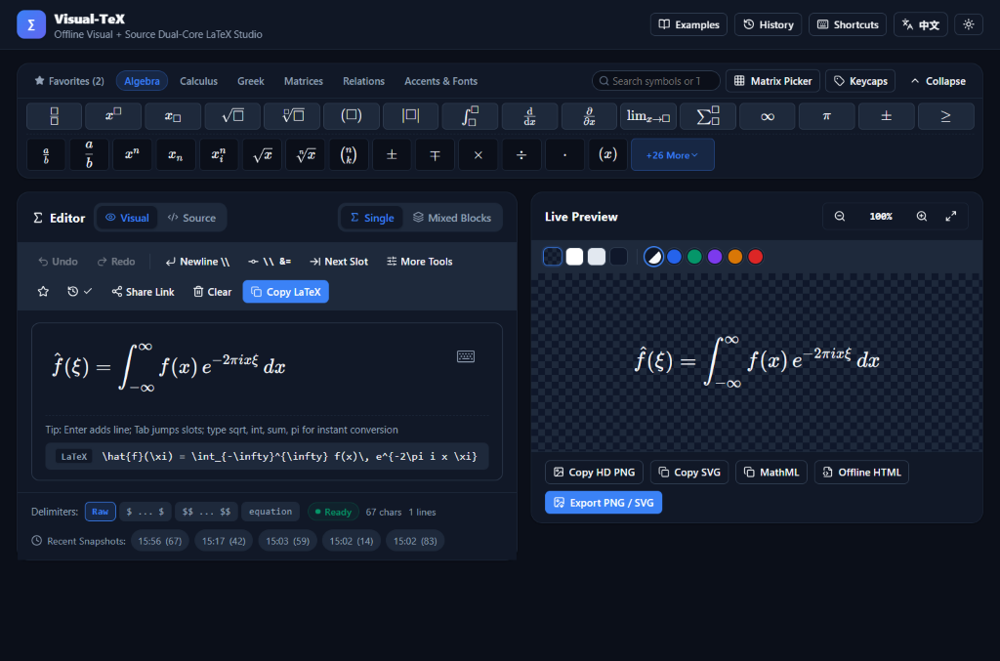
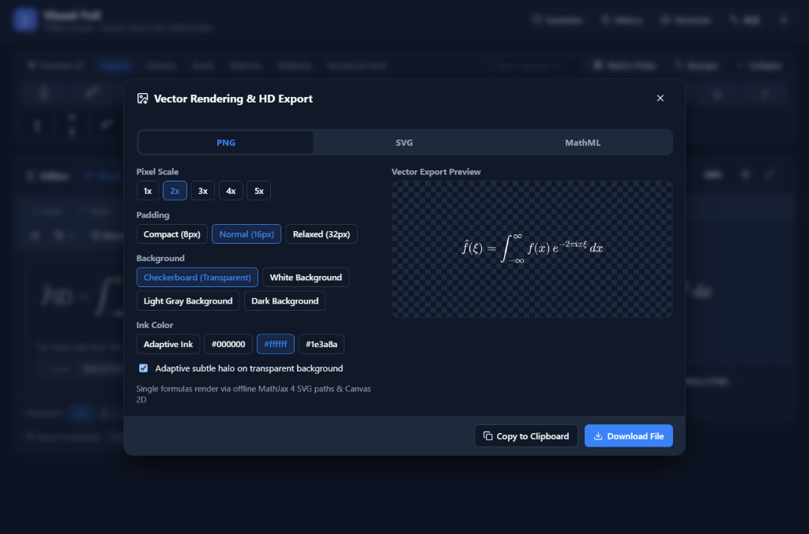
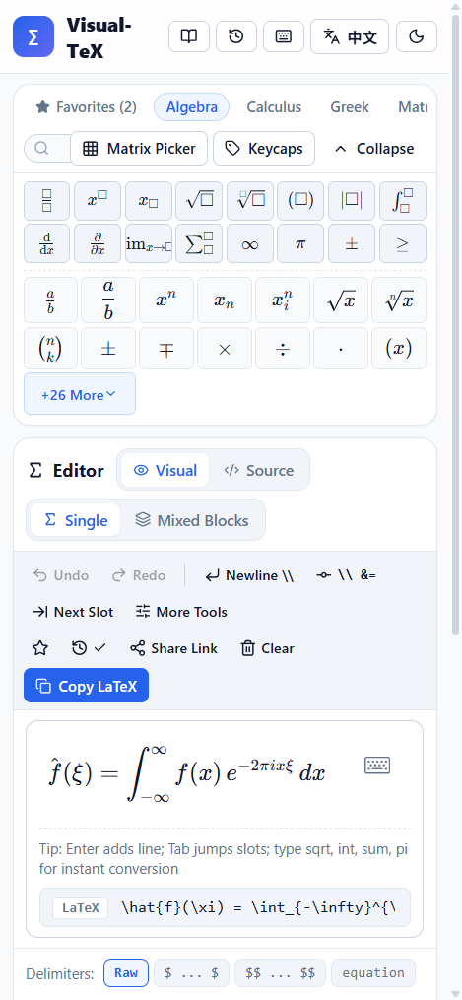
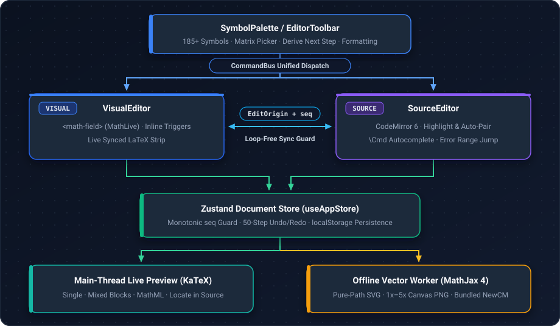

<div align="center">

# Visual-TeX

**100% Offline Visual + Source Dual-Core LaTeX Equation & Mixed Markdown Studio for Research, Education, and Publishing**

[](https://aistudio.google.com/)
[](https://visual-tex.ai.studio)
[](LICENSE)

[](https://react.dev/)
[](https://www.typescriptlang.org/)
[](https://cortexjs.io/mathlive/)
[](https://katex.org/)
[](https://www.mathjax.org/)

<p>
  <a href="./README.md">简体中文</a> | <strong>English</strong>
</p>

<p>
  <a href="https://visual-tex.ai.studio">Live Demo</a> ·
  <a href="#-overview">Overview</a> ·
  <a href="#-key-features">Key Features</a> ·
  <a href="#-quick-start">Quick Start</a> ·
  <a href="#-shortcuts--inline-triggers">Shortcuts</a> ·
  <a href="#-architecture--project-structure">Architecture</a>
</p>

</div>

---

## 📖 Overview

**Visual-TeX** is a pure frontend, **100% offline** LaTeX formula and mixed Markdown+Math studio built for academic writing, lecture slides, engineering documentation, and daily technical notes.

By uniting **WYSIWYG math structure editing (MathLive)** with **precision LaTeX code control (CodeMirror 6)**, Visual-TeX streamlines the full authoring-to-publication workflow:

- **Bidirectional Dual-Core Sync**: Switch effortlessly between visual placeholder-guided editing, backslash-free inline triggers, and CodeMirror 6 source editing with command completions and syntax error location—kept loop-free via a monotonic transaction state machine.
- **Focused Palette, Zero Network Dependency**: Features a compact 16-key pinned **Core Pad** and a restrained two-row expandable palette (`+N More`) so symbol walls never crowd the canvas. All fonts and rendering engines are bundled locally for full offline reliability.
- **Publication-Grade Vector & Document Output**: Main-thread KaTeX delivers sub-millisecond live previews, while an isolated Web Worker runs MathJax 4 + NewCM fonts to export **pure-path SVG** (no `<foreignObject>`), **1x–5x Canvas 2D PNG**, and **Word-native MathML**, across desktop, tablet, and mobile viewports.

---

## ✨ Key Features

### ⌨️ Dual-Core Synergy: MathLive Visual × CodeMirror 6 Source

- **WYSIWYG `<math-field>` (MathLive)**: Physical math cursor navigation, **Wrap Selection** (`${SEL}`), and structured `\placeholder{}` slot navigation (`Tab` / `Shift+Tab` across slots, `Enter` for multiline `\\`, `Shift+Enter` to exit the parent group).
- **Live Synced LaTeX Strip**: An editable `LaTeX` source bar sits directly beneath the visual field so you can inspect, paste, or tweak raw TeX without switching editor tabs.
- **CodeMirror 6 Source Editor**:
  - Custom `StreamLanguage` LaTeX syntax highlighting and automatic `{}` / `()` / `[]` bracket pairing.
  - Typing `\` opens an autocomplete popover covering 26 common structures (`\frac`, `\dfrac`, `\sqrt`, `\sum`, `\prod`, `\int`, `\lim`, `\mathbb`, `\begin{cases}`, `\begin{aligned}`, `\begin{pmatrix}`, etc.).
  - Space-triggered inline expansion (`>= ` → `\geq `, `-> ` → `\to `, `oo ` → `\infty `, `alpha ` → `\alpha `, etc.) that safely skips `\text{}` environments.
  - **Locate in Source**: When KaTeX reports a syntax error, clicking **Locate in Source** automatically switches to Source mode and highlights the exact offending span.

### 🧮 Compact Two-Row Symbol Palette (185+ Symbols)

- **16-Key Pinned Core Pad**: Keeps fraction, power, subscript, square root, $n$-th root, parentheses, absolute value, definite integral, derivative, partial derivative, limit, sum, infinity, $\pi$, $\pm$, and $\ge$ pinned in one row (reflowing cleanly into an 8-column two-row grid on mobile).
- **6 Subject Categories (185+ Symbols) + Starred Favorites (`★`)**: Covers **Algebra**, **Calculus**, **Greek**, **Matrices**, **Relations**, and **Accents & Fonts**. Multi-argument templates come pre-wired with full `\placeholder{}` slots and pass KaTeX verification tests.
- **Restrained Two-Row Default View**: Each tab shows the top two rows by default with an inline `+N More ▾ / Less ▴` toggle, plus a **Keycaps / Labels** view toggle.
- **Interactive 1×1–6×6 Matrix Picker**: Hover and click to generate arbitrary matrix and piecewise environments (`(pmatrix)`, `[bmatrix]`, `|vmatrix|`, `{cases}`), paired with quick toolbar controls (`+ Row`, `- Row`, `+ Col`, `- Col`).
- **Bilingual Fuzzy Search**: Filter the entire catalog by English keywords, Chinese names, or TeX commands and press `Enter` to insert the top match immediately.

<div align="center">
  
</div>

---

### 🎨 100% Offline Dual-Engine Rendering & HD Export

- **Main-Thread Live Preview (`KaTeX`)**: Sub-millisecond feedback with transparent checkerboard, white, light gray, or dark canvas backgrounds, adaptive or custom ink colors, and `50%`–`300%` / Fit-Width zoom controls.
- **Background Vector Export (`Web Worker + MathJax 4 + NewCM`)**: Compiles TeX to **pure-path SVG** inside a dedicated Web Worker with zero `<foreignObject>` elements or external font dependencies—ready for Figma, Illustrator, Inkscape, Typst, and web embeds.
- **Native Canvas 2D High-DPI PNG**: Export with **1x–5x pixel scale**, **Compact (`8px`) / Normal (`16px`) / Relaxed (`32px`)** canvas padding, and an **adaptive subtle halo** toggle that keeps transparent equations readable on both dark and light slides.
- **Multi-Format Interop**: Copy **PNG**, **SVG**, or **MathML** (paste directly into Microsoft Word as editable native equations), download a self-contained **Offline HTML** file, or copy a serverless **URL `#tex=` Share Link**.

<div align="center">
  
</div>

---

### 📝 Single Equation × Mixed Blocks Workspace & Responsive Design

<table>
  <tr>
    <td valign="top">
      <h4>Dual Document Workflows & Derivation Helpers</h4>
      <ul>
        <li><strong>Single vs. Mixed Blocks Toggle</strong>: Switch seamlessly between focused single-equation editing and multi-block Markdown + LaTeX documents. Only the active math block mounts a heavy editor while inactive blocks stay fast static KaTeX renders.</li>
        <li><strong>Workflow Accelerators</strong>: One-click <code>Next Step (\\ &amp;=)</code> appends aligned derivation steps; <strong>Normalize CJK/Width</strong> cleans fullwidth punctuation and wraps CJK text in <code>\text{}</code>; pasted formulas from papers, Word, or AI chats are automatically normalized.</li>
        <li><strong>Markdown Import &amp; Export</strong>: Paste or upload <code>.md / .tex</code> files to split prose and display math blocks automatically, and export with <code>Raw</code>, <code>$ ... $</code>, <code>$$ ... $$</code>, or <code>equation</code> delimiters.</li>
        <li><strong>Safety Net</strong>: 50-step transactional Undo/Redo stack, <code>localStorage</code> persistence, 11 classic formula presets, local history with custom notes, and clickable version snapshots.</li>
      </ul>
      <h4>Desktop, Tablet &amp; Mobile Adaptation</h4>
      <ul>
        <li><strong>Responsive Breakpoints</strong>: Sticky dual-column layout on desktop; single-column flow on tablet; compact header, swipeable category tabs, 8-column core grid, and full-width modals on mobile (<code>&lt;= 640px</code>).</li>
        <li><strong>Polished Details</strong>: Custom <code>6px</code> pill scrollbars with native <code>color-scheme</code>, Light / Dark themes, and instant Chinese / English UI switching.</li>
      </ul>
    </td>
    <td width="300" align="center" valign="middle">
      
      <br />
      <sub><i>375×812 Mobile Responsive Light Mode</i></sub>
    </td>
  </tr>
</table>

---

## 🚀 Quick Start

### Option 1: Online Web App

Open **[visual-tex.ai.studio](https://visual-tex.ai.studio)** in any modern browser—zero installation required, with support for restoring shared states via `#tex=` URL hashes.

### Option 2: Local Development & Self-Hosting

**Prerequisites**: Node.js `>= 20` (Node.js 22 LTS recommended) and npm `>= 10` (or pnpm / bun).

```bash
# 1. Clone the repository
git clone https://github.com/minJohnzi/Visual-TeX.git
cd Visual-TeX

# 2. Install dependencies
npm install

# 3. Start the dev server (http://localhost:3000)
npm run dev
```

### NPM Scripts

| Command | Description |
| :--- | :--- |
| `npm run dev` | Start Vite development server on port `3000` |
| `npm run lint` | Run `tsc --noEmit` static TypeScript type checking |
| `npm test` | Run the Vitest + JSDOM unit & integration test suite |
| `npm run build` | Build a 100% offline static bundle into `dist/` |
| `npm run preview` | Preview the production `dist/` build locally |

---

## ⚡ Shortcuts & Inline Triggers

### Visual Mode Backslash-Free Inline Triggers

Type these shortcuts directly inside `<math-field>` to expand mathematical structures without leading backslashes:

| Category | Triggers | Output |
| :--- | :--- | :--- |
| **Templates** | `sqrt`, `nthroot`, `int`, `sum`, `prod`, `lim` | Root, definite integral, sum, product, and limit slot templates |
| **Symbols & Arrows** | `pi`, `inf` / `oo` / `infty`, `part`, `pm`, `mp`, `>=`, `<=`, `!=`, `->`, `=>` | $\pi$, $\infty$, $\partial$, $\pm$, $\mp$, $\ge$, $\le$, $\ne$, $\to$, $\implies$ |
| **Greek Letters** | `alpha`, `beta`, `gamma`, `delta`, `theta`, `lambda`, `sigma`, `omega` | $\alpha$, $\beta$, $\gamma$, $\delta$, $\theta$, $\lambda$, $\sigma$, $\omega$ |

### Global & Source Mode Shortcuts

| Shortcut | Scope | Action |
| :--- | :--- | :--- |
| `Tab` / `Shift + Tab` | Global | Jump forward / backward across `\placeholder{}` slots |
| `Ctrl / Cmd + Z` | Global | Undo last edit (up to 50 transaction steps) |
| `Ctrl / Cmd + Shift + Z` | Global | Redo undone edit |
| `Enter` / `Shift + Enter` | Visual Mode | Insert aligned newline `\\` / step out of parent delimiter or structure |
| `\` + command prefix | Source Mode | Trigger CodeMirror 6 LaTeX command autocomplete |
| `>=` / `<=` / `!=` / `->` / `<-` / `oo` + `Space` | Source Mode | Auto-expand to `\geq` / `\leq` / `\neq` / `\to` / `\leftarrow` / `\infty` |

---

## 🏗️ Architecture & Project Structure

### Transaction Flow & Dual-Engine Pipeline

Visual-TeX prevents circular updates between Visual and Source editors via a Zustand transaction model tagged with `EditOrigin` (`visual` / `source` / `command` / `history` / `external`) and a monotonic sequence number (`seq`). Live previews execute synchronously on the main thread with **KaTeX**, while high-precision SVG vector compilation and high-DPI PNG rasterization run offline inside a **MathJax 4 + NewCM Web Worker**.

<div align="center">
  
</div>

### Tech Stack

| Layer | Core Packages (`package.json`) | Responsibility |
| :--- | :--- | :--- |
| **Core Runtime** | React `19` + TypeScript `7.0` + Vite `8` | Strict TypeScript UI components & ES module Worker bundling |
| **State Machine** | Zustand `5.1` (`useAppStore`) | `EditOrigin` loop-free store, 50-step Undo/Redo, `localStorage` persistence |
| **Visual Input** | MathLive (`mathlive`) | `<math-field>` structural editing, slot jumping & inline triggers |
| **Source Input** | CodeMirror 6 (`@codemirror/*` + `@lezer/highlight`) | StreamLanguage highlighting, `\` completions, auto-pairing & error highlight |
| **Live Preview** | KaTeX (`katex`) | Synchronous sub-millisecond rendering for equations, mixed blocks & MathML |
| **Vector Export** | MathJax 4 (`@mathjax/src` + `@mathjax/mathjax-newcm-font`) | Offline Worker-based TeX → pure-path SVG compilation |
| **Mixed Capture** | `html-to-image` | High-resolution DOM capture for Mixed Markdown+Math PNG exports |
| **Testing** | Vitest `5` + JSDOM | Unit & integration coverage across palette, store, bridge, mixed parser & export modal |

### Directory Tree

```text
Visual-TeX/
├── docs/
│   └── screenshots/              # README showcase screenshots (Desktop / Export / Mobile)
├── public/                       # Static assets and favicon
├── src/
│   ├── commands/                 # Decoupled CommandBus & tests
│   ├── components/
│   │   ├── editor/               # BlockWorkspace, EditorToolbar, VisualEditor, SourceEditor
│   │   ├── modals/               # ExamplesModal, HelpModal, HistoryModal, ToastContainer
│   │   ├── ErrorBoundary.tsx     # Render fallback boundary
│   │   ├── ExportModal.tsx       # Pure-path SVG / 1x–5x PNG / MathML export modal
│   │   ├── FormulaPreview.tsx    # KaTeX live preview canvas, zoom & delimiter controls
│   │   └── SymbolPalette.tsx     # 16-key Core Pad, 6-category palette & interactive Matrix Picker
│   ├── core/
│   │   ├── export/               # MathJax Worker client, DOM PNG, clipboard, offline HTML, URL share
│   │   ├── latex/                # MathLive/KaTeX bridge, protocol normalizer, matrix ops, scanner, shortcuts
│   │   ├── markdown/             # Mixed Markdown + inline/display math parser & renderer
│   │   └── types.ts              # Core domain types
│   ├── data/                     # 185+ bilingual symbols, 16 Core Pad items & 11 classic formulas
│   ├── i18n/                     # Bilingual (ZH / EN) React Context & strictly typed locales
│   ├── store/                    # Zustand store, 50-step Undo/Redo & persistence helpers
│   ├── styles/                   # tokens.css (themes & 6px pill scrollbars), components/editor/preview CSS
│   └── workers/                  # Offline MathJax 4 pure-path SVG compiler Web Worker
├── package.json
├── vite.config.ts
└── vitest.config.ts
```

---

## 🤝 Acknowledgements & License

Visual-TeX stands on the shoulders of outstanding open-source projects:

- [MathLive](https://cortexjs.io/mathlive/) — Interactive mathematical field editor
- [KaTeX](https://katex.org/) — Fast math typesetting engine for the web
- [MathJax](https://www.mathjax.org/) — Publication-grade offline TeX-to-SVG pure-path renderer
- [CodeMirror 6](https://codemirror.net/) — Extensible modern code editor framework
- [Zustand](https://zustand-demo.pmnd.rs/) — Minimal, predictable React state management
- [Lucide](https://lucide.dev/) — Clean open-source icon toolkit

Released under the [MIT License](LICENSE). Issues and Pull Requests are always welcome!
